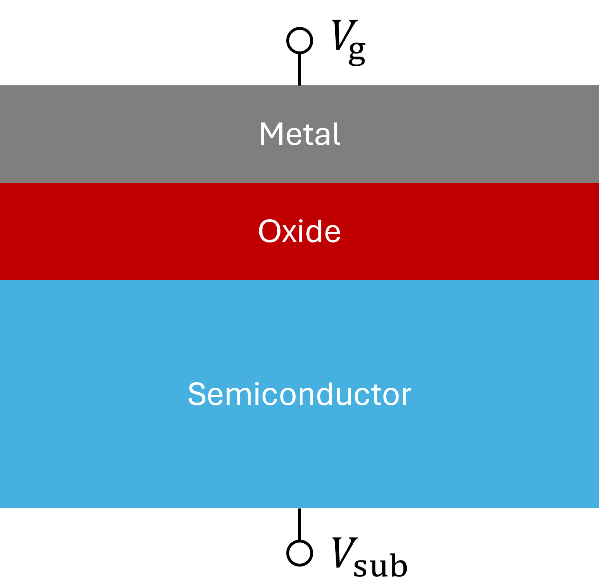
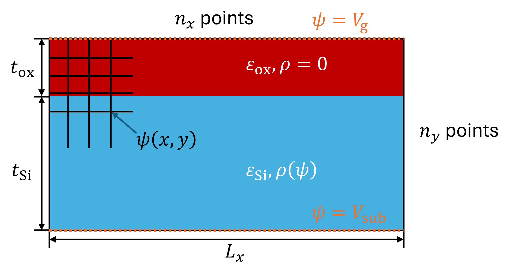

* _this is an example file you should finish_
* write problem description, how the algorithm/baseline code works, and where you think you can apply parallel computing
* if you are looking at this file from Jupyter, you can see the preview by right-clicking on the cell and "Show Markdown Preview"

# Making 2D MOS electrostatic simulation from scratch

# Problem



MOS (Metal-Oxide-Semiconductor) is an important structure in the field of semiconductors. The problem is to calculate electrostatic potential of this structure. 



The simulation condition is shown above.

The basic poisson equation of electrostatics
$$\nabla\cdot(\varepsilon\nabla\psi) = -\rho$$
should be true in all points, where $\psi$ is electrostatic potential (voltage), $\rho$ is charge density and $\varepsilon$ is  permittivity.

There is no free charge in oxide: $\rho=0$ in oxide.

In semiconductor, the charge density depends on the potential:
$$\rho=-q[p_0 e^{-\psi/V_T} - n_0 e^{\psi/V_T} + N_D - N_A]$$
where $n_0$ and $p_0$ are thermal equilibrium concentration of electron and hole, $N_D$ and $N_A$ are doner and acceptor concentration and $V_T=k_bT/q$ is thermal voltage.

# How the algorithm/baseline code works

This algorithm updates $\psi$ until convergence.

```
for (iter = 1; iter <= max_iters; ++iter) {
  for (sweep = 0; sweep < inner_jacobi; ++sweep) {
    update_psi();
  }
  if (converged) break;
}
```

I actually have no idea why there are double loops.

Inside `update_psi()`

```
for (j = 1; j < ny - 1; ++j) {
  for (i = 1; i < nx - 1; ++i) {
    rho = calculate_rho_from_psi();
    g = calculate_residual(rho);
    psi_new[j][i] = calculate_update_amount(psi[j][i], g);
  }
}
copy_psi_new_to_psi();
```

Residual $g$ is an error of the poisson equation, which should be zero ideally. We can calculate how much to update $\psi$ by using $g$ and $dg/d\psi$.

I manually added comments for better understanding and TODOs.

# Where is parallelism

- The entire grid can be updated in parallel.
