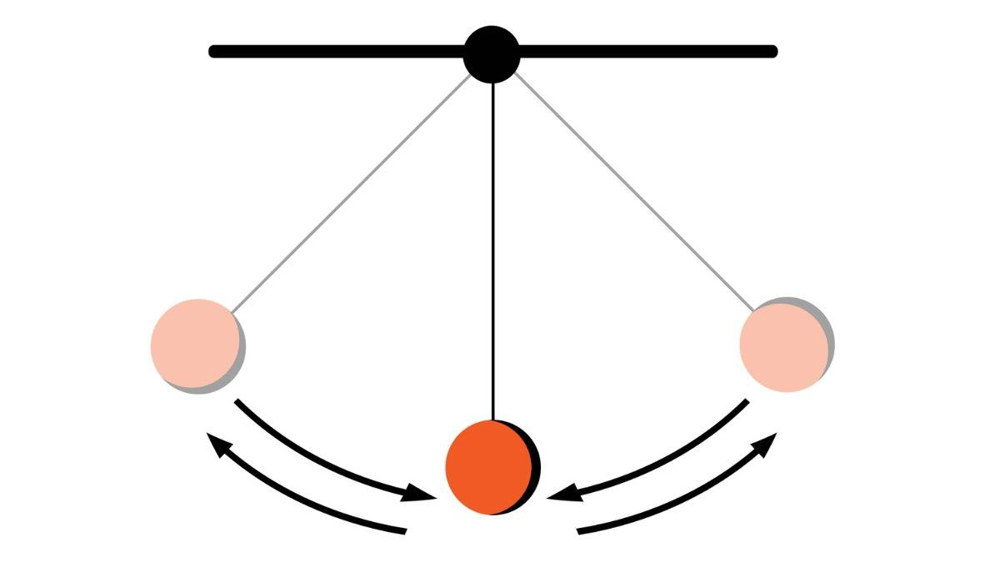
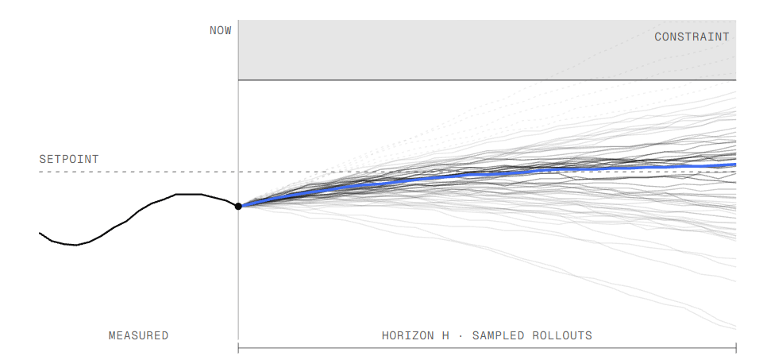

# Sampling-based Model Predictive Control

## Problem

I implement a serial baseline of Model Predictive Path Integral control (MPPI) for a simple pendulum. The model can be changed, but I use a pendulum as a baseline. The pendulum starts from the hanging-down position and the controller must swing it up and stabilize it near the upright position.

At each control step, MPPI samples many random control sequences, simulates the pendulum forward for each sequence, computes a trajectory cost, and updates the nominal control sequence by a cost-weighted average of sampled noise.

This is a realistic robotics control workload with many repeated simulations, which makes it a good target for later parallelization.

## How the algorithm/baseline code works

The implementation is in `mppi.cpp` and uses only standard C++17. A more detailed explanation of the algorithm can be found [here](https://acdslab.github.io/mppi-generic-website/docs/mppi.html). I have also tried to comment as much as I can in the code file itself.

- Pendulum dynamics (assume mass = length = 1):
  - state: angle `th` and angular velocity `thd`. `th = 0` when upright, and `pi` when hanging down
  - control: torque `u` clipped to `[-UMAX, UMAX]`
  - timestep: `DT = 0.02`
  - update:
    - `thd += (g*sin(th) - damp*thd + u) * DT`
    - `th  += thd * DT`
- Cost:
  - stage cost: `(1 - cos(th)) + 0.01*thd^2 + 0.001*u^2`
  - terminal cost: `10*(1 - cos(th)) + 0.1*thd^2`
- MPPI loop (receding horizon):
  1. For each sample `k = 0..K-1`, draw Gaussian noise over horizon `T`, apply perturbed controls, and accumulate total cost.
  2. Convert costs to normalized exponential weights using temperature `lambda`.
  3. For each horizon time `t`, compute weighted average noise and add it to nominal control `U[t]`.
  4. Apply only the first control to the real system, shift `U` left by one step, and repeat.

Command-line parameters: `K T steps lambda sigma`.
Default values are `K=4096`, `T=100`, `steps=600`, `lambda=1.0`, `sigma=1.0`.

The code prints periodic diagnostics (`theta`, `omega`, min sampled cost, effective sample size), final success/failure, and elapsed computation time.

## Where is parallelism

The biggest parallel region is the rollout loop over sampled trajectories (`k`).
Each sample is independent during simulation and cost accumulation.
<!--
- Multicore CPU:
  - parallelize the loop over `k`
  - each thread computes local costs (and local weighted sums for control update), then reduce
- GPU:
  - one thread (or warp) per trajectory rollout
  - evaluate dynamics and costs in parallel for all samples
  - then perform reductions for weights and weighted noise sums

Potential speedup limits:
- memory bandwidth for storing noise/cost arrays
- reduction overhead for normalization and weighted averaging
- serial dependence across outer control steps (`steps` loop is receding-horizon and must stay ordered)

Correctness checks:
- final state near upright (`|theta|` small, `|omega|` small)
- stable behavior across multiple runs with fixed seed
- trend of decreasing minimum sampled cost during swing-up
