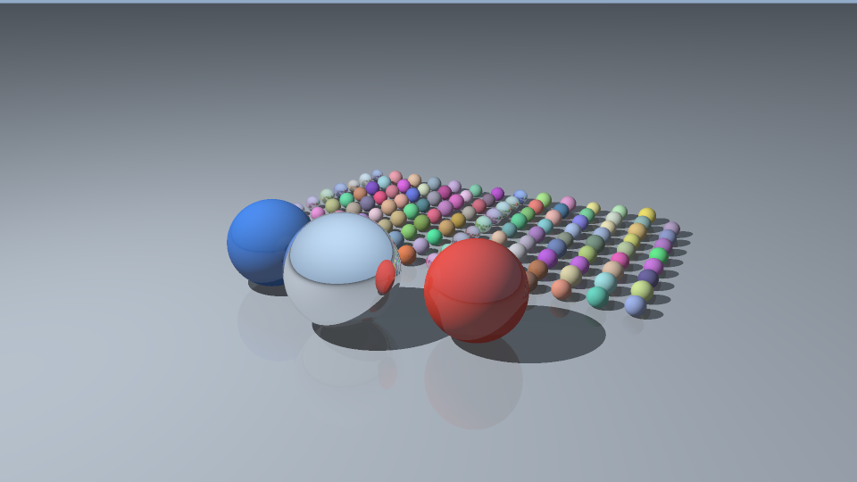

# Making a Ray Tracer from Scratch

> Draft for student review: read, check, and rewrite this description in your
> own words before submission. Classmates will read it. Miyabi compilation,
> execution, and performance measurements are **not yet verified**.

## Problem and motivation

A ray tracer turns a three-dimensional scene into a two-dimensional image by
following rays from a camera. This is useful in computer graphics, product
visualization, and film rendering. Each pixel asks which surface is visible and
how that surface is lit.

This project generates its own scene: colored spheres, a large mirror sphere,
an infinite ground plane, a pinhole camera, and one point light. It outputs a
binary RGB PPM image. The program supports ambient light, Lambert diffuse light,
hard shadows, ideal mirror reflections, and grid supersampling to reduce jagged
edges. It is a fully serial C++17 baseline using only the standard library, with
no downloaded inputs or dependencies.

## How the baseline code works

For each pixel, the program traces a regular `s` by `s` grid of camera rays,
sampling the centers of the grid cells. Each ray tests every sphere and the plane
to find the nearest positive intersection. Missing rays see a sky gradient.
For a surface hit, ambient light contributes 0.13 times the material color.
Diffuse light contributes `0.87 * max(0, dot(normal, direction_to_light))` times
the color, unless another object blocks the segment from the hit to the light.
The point light has constant strength; distance attenuation is not modeled.

A reflective surface traces one mirror ray. With reflectivity `r`, its color is
`(1-r) * local_color + r * reflected_color`. `--max-depth d` allows at most `d`
mirror bounces after the camera ray. At depth zero, the terminal color is the
full local lighting, including shadows; no mirror ray is spawned. This cutoff
is a visual approximation. Secondary origins are offset by `1e-5` scene units
to avoid self-intersection. Shadow intersections are bounded by the distance
to the light, so objects behind the light cannot block it.

Samples are averaged in linear color space. Each averaged channel is clamped
to `[0,1]`, converted with gamma 2.0 (`sqrt`), rounded to an 8-bit value, and
stored in a flat RGB buffer. The buffer is written as PPM P6.

The first three spheres have fixed positions and materials. Additional spheres
occupy a fixed background rectangle. Their radii shrink as their count grows,
keeping the scene within the camera view. Some can still occlude others, and
very small spheres need more pixels or samples to remain visible. The camera
moves back for portrait images. Scene variation uses `std::mt19937` and an
explicit mapping of its integers to real numbers; pixel sampling uses no random
state. The seed affects background spheres, so it has no effect with 1--3 spheres.

All implementation and self-tests are in `raytrace.cpp`:

| Data or function | Responsibility |
| --- | --- |
| `Vec3`, `Ray`, `Material`, `Hit` | Vector arithmetic, rays, surface color/reflectivity, and intersection data |
| `Sphere`, `Plane`, `Scene` | A contiguous vector of spheres, a ground plane, and the light position |
| `Camera`, `make_camera` | Set position, target, up direction, and field of view; generate pinhole rays |
| `make_scene` | Generate a deterministic scene outside the render timer |
| `hit_sphere`, `hit_plane`, `closest_hit` | Solve intersections and select the nearest valid surface |
| `shadowed`, `trace` | Check visibility to the light, shade the surface, and recursively reflect |
| `render`, `encode` | Sample pixels, average linear colors, check finiteness, and encode RGB bytes |
| `write_ppm`, `self_test` | Serialize the image and run lightweight automated checks |

For width `W`, height `H`, grid size `s`, sphere count `N`, and maximum depth `d`,
the worst-case work is `O(W * H * s^2 * (d+1) * (N+1))`. Each bounce performs
a full intersection scan and at most one shadow scan. There is only one mirror
child per hit, so ray count is not exponential in depth. Many rays stop earlier.
Memory is `O(N + W*H + d)`, including 3 bytes per output pixel and the reflection
call stack. No acceleration structure is used.

## Build and run

Use the notebook's **Python (Miyabi G)** kernel. The compile cell keeps the course
environment line and checks the compiler on Miyabi before compilation.
Its availability and version are still pending verification there.

```bash
%%bash
set -e
cd code
module purge && module load nvidia/25.9 cuda/12.9 && PATH=/work/gt81/share/env/llvm/bin:$PATH
command -v clang++
clang++ --version
clang++ -O3 -Wall -Wextra -pedantic -std=c++17 raytrace.cpp -o raytrace
```

Run `%load_ext miyabi` once per kernel in its separate cell. The run cell uses
the existing course job configuration without adding scheduler options:

```bash
%%sub
set -e
cd code
./raytrace --self-test
./raytrace --width 320 --height 180 --samples-per-axis 1 --spheres 16 --max-depth 2 --seed 42 --output quick.ppm
./raytrace --width 960 --height 540 --samples-per-axis 2 --spheres 128 --max-depth 3 --seed 42 --output result.ppm
```

The second render starts calibration; it is not a promised runtime. Read its
actual timing on Miyabi, then increase resolution, sampling, or object count
gradually if needed. Doubling both dimensions or doubling `s` roughly quadruples
primary rays; doubling `N` roughly doubles intersection work. Aim for seconds to
a few minutes, within the 15-minute job limit. Do not extend runs with empty work
or repeated renders.

Wait for the job to finish successfully before conversion and display:

```bash
%%bash
set -e
convert code/result.ppm code/result.png
```

```python
from IPython.display import Image, display
display(Image("code/result.png"))
```

Conversion is postprocessing, not a C++ dependency. If the Miyabi environment
check fails, retain the exact error and ask the instructor. The local AI
environment cannot submit Miyabi jobs.

| Option | Default | Meaning and accepted values |
| --- | --- | --- |
| `--width` | 320 | Width in pixels, 1--16384 |
| `--height` | 180 | Height in pixels, 1--16384 |
| `--samples-per-axis` | 1 | Grid side `s`, 1--32; `s*s` samples per pixel |
| `--spheres` | 16 | Total spheres including foreground objects, 1--100000 |
| `--max-depth` | 2 | Maximum mirror bounces, 0--32; zero uses local shading only |
| `--seed` | 42 | Scene seed, 0--4294967295 |
| `--output` | `result.ppm` | Nonempty PPM path; parent directory must exist; existing file is overwritten |
| `--self-test` | off | Run tests and exit without rendering a file |
| `--help` | off | Print usage and exit |

Total image size is limited to 67,108,864 pixels to bound buffer memory. These
limits do not guarantee short runtimes for combined large settings. Malformed
arguments, out-of-range values, and output errors print an English error and
return nonzero status.

## Correctness checks

Local validation on 2026-10-29: **29/29 self-tests passed**. They cover:

- Sphere distance 4 for the specified ray and sphere; misses, inside origins,
  negative intersections, tangents, non-unit directions, and nearest-hit ordering.
- Plane distance 2, parallel rays, and intersections behind the origin.
- Shadow blockers before the light, blockers beyond it, and ground self-shadow
  prevention.
- Reflection direction, depth-zero lighting, one bounce to the sky, exact
  local/mirror mixing, and a ray enclosed in a mirror sphere terminating after
  32 bounces. Sampled colors at several depths contain no NaN or infinity.
- Camera orientation, gamma/clamping, linear grid averaging, PPM header and
  binary payload size, and deterministic repeated scene generation/rendering.
- Seed variation, correct sphere counts, and camera bounds for 1, 3, 16, 128,
  and 1000 spheres in landscape and portrait images.

Additional local checks passed for 16 invalid-input/output-failure cases and
help text. Successful tiny runs included a 1x1 image with one sphere, depth zero
and seed zero, and a portrait image with seed 4294967295. Two separate processes
produced identical complete preview PPM files. A depth-zero image differed from
the reflected version, as expected.

The preview below was visually inspected. It shows round colored spheres,
foreground occlusion, shadows extending away from the light, a sky/ground split
and a red neighbor reflected in the large mirror sphere, and faint ground
reflections. A 128-sphere small render was also inspected: the background grid
stays in view. The depth-zero comparison removes mirror and ground reflections.
These checks support the analytic tests but do not prove physical accuracy.



**This PNG is a local preview, not a Miyabi result.** Its PPM payload size was
checked; PNG conversion passed a lossless pixel round trip. ImageMagick is absent
locally, so temporary Python standard-library postprocessing converted this
preview. The renderer needs no Python code. The notebook retains the course's
`convert` command for Miyabi.

Within the same executable/environment, repeated parameters and seeds should
produce identical bytes. The printed FNV-1a pixel checksum helps compare runs;
it is not a correctness proof. Future CPU/GPU comparisons should allow
floating-point and pixel tolerances, especially at edges and shadow boundaries.
Cross-platform byte identity is not assumed.

## Measurement

`std::chrono::steady_clock` measures two intervals. The render timer encloses
only `render`: ray generation, intersections, shading, reflections, averaging,
finite-color checks, gamma conversion, and buffer writes. Scene generation,
camera setup, buffer allocation/initialization, parameter printing, and checksums
are outside it. The write timer includes open, PPM header and byte writes, and
close; it measures writes through the operating system cache, not guaranteed
durable storage. PNG conversion is outside both intervals.

Every render prints effective parameters, render/write seconds, a pixel checksum,
mean RGB byte value, and `nonfinite_pixels=0` on success. Nonfinite color is an
error rather than silently encoded as a pixel.

Actual local environment: aarch64 Linux AI execution host, GCC
`g++ (Ubuntu 15.2.0-16ubuntu1) 15.2.0`. This compile completed without warnings:

```bash
g++ -O2 -Wall -Wextra -pedantic -std=c++17 code/raytrace.cpp -o /tmp/pd02-raytrace.baGXTq/raytrace
/tmp/pd02-raytrace.baGXTq/raytrace --self-test
/tmp/pd02-raytrace.baGXTq/raytrace --width 320 --height 180 --samples-per-axis 1 --spheres 16 --max-depth 2 --seed 42 --output /tmp/pd02-raytrace.baGXTq/quick.ppm
/tmp/pd02-raytrace.baGXTq/raytrace --width 640 --height 360 --samples-per-axis 2 --spheres 16 --max-depth 2 --seed 42 --output /tmp/pd02-raytrace.baGXTq/preview.ppm
```

These are short functional checks, not Miyabi benchmarks. All use seed 42;
local PPM writes went to temporary storage. Each row is one observed run:

| Environment / image | W x H | s | N | d | Render seconds | PPM write seconds | Pixel checksum (hex) |
| --- | --- | --- | --- | --- | --- | --- | --- |
| Local quick | 320 x 180 | 1 | 16 | 2 | 0.016788 | 0.000160 | `247645d9d5441b47` |
| Local retained preview | 640 x 360 | 2 | 16 | 2 | 0.258597 | 0.000511 | `56e15c2ce09e645c` |
| Local determinism repeat | 640 x 360 | 2 | 16 | 2 | 0.258587 | 0.000417 | `56e15c2ce09e645c` |
| Local dense scene | 320 x 180 | 1 | 128 | 2 | 0.082134 | 0.000184 | `c30c9979d2cea2f2` |
| Miyabi calibration start | 960 x 540 | 2 | 128 | 3 | **Pending** | **Pending** | **Pending** |

Notebook commands are filled in but have not run in a Miyabi kernel. Shell file
checks were executed locally. No notebook execution output has been fabricated.
After your Miyabi run, record its compiler version, parameters, render/write
times, checksum, and visual observations here. Update the preview description
when the Miyabi output replaces `result.png`.

## Where is parallelism?

- **Multicore CPU:** assign independent pixels or tiles to workers. Each worker
  writes a disjoint buffer region and uses a private accumulator. The scene is
  read-only. Small dynamically scheduled tiles can balance pixels with different
  reflection depths; scheduling overhead and memory bandwidth may limit scaling.
- **SIMD:** test several spheres against the same ray in vector lanes. A future
  structure-of-arrays layout for centers/radii can support contiguous loads;
  nearest-hit reduction and irregular branches require care.
- **GPU:** start with one thread per pixel and contiguous RGB output. Put scene
  data in flat arrays without host pointers; consider separate coordinate arrays
  for memory access. Replace recursion with a bounded bounce loop. Different ray
  paths, shadow outcomes, and bounce counts cause divergent work. Geometry reads,
  register pressure, and transfers can also limit speedup.
- **BVH:** a bounding volume hierarchy can skip distant groups of spheres. This
  is a later algorithmic improvement. Measure serial brute force, parallel brute
  force, and accelerated variants separately to distinguish reduced work from
  parallel execution. Account for BVH construction where relevant.

Keep scenes, sampling, depth, compiler options, image quality, and timing
boundaries comparable. No speedup is claimed before measurement.

## Limitations and submission

Only spheres and one two-sided ground plane are supported. Lighting is one white
point source plus ambient light. Mirrors are ideal; shadows are hard. There is
no refraction, texture, soft shadow, indirect illumination, model loader, GUI,
multithreading, GPU code, or acceleration structure. Full scans grow linearly
with object count. Finite depth, fixed ray offsets, clamping, gamma 2.0 (not the
exact sRGB curve), and finite sampling introduce visual/numerical approximations.
High sphere counts can require more resolution to resolve.

Before submission, personally compile/run on Miyabi, tune the workload, inspect
the image, fill pending measurements, and review/rewrite this draft. Keep
`raytrace.cpp`, `problem.md`, and the reviewed `result.png` in `code/`. After
converting and verifying the final PNG, remove only generated executables and
PPM intermediates (`code/raytrace`, `code/quick.ppm`, `code/result.ppm`). Keep the
course notebook and required course files; inspect the whole directory for
unrelated files before submitting manually through Jupyter.
