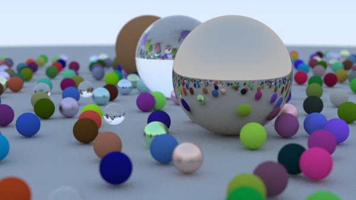

* _this is an example file you should finish_
* write problem description, how the algorithm/baseline code works, and where you think you can apply parallel computing
* if you are looking at this file from Jupyter, you can see the preview by right-clicking on the cell and "Show Markdown Preview"

# Making ray tracer from scratch

# Problem

This code draw the picture of a virtual scene by ray tracing algorithm.

For each pixel of image, ray tracer shoot rays to the scene and calculate the pixel color. Ray can reflect or refract when it intersect with objects.
This algorithm is the basis for CG animation.

I read Ray Tracing in One Weekend[<sup>1</sup>](#id_01). This is an e-book which I've wanted to read for a long time.


I implemented the code following the book; I implemented the most of code with copy & paste. I only modified the code to set parameters as arguments.

The code produce image as below.


# How the algorithm/baseline code works

I show the render function in `camera` class in `camera.h` below. For each pixel of an image, we shoot rays `samples_per_pixel` times and calculates the average of it. This is called Monte Carlo Integration.

Since this code has 3 nesting loop, it could be very slow if we use large parameters.

```
for (int j = 0; j < image_height; j++) {
    // ...
    for (int i = 0; i < image_width; i++) {
        color pixel_color(0,0,0);
        for (int sample = 0; sample < samples_per_pixel; sample++) {
            ray r = get_ray(i, j);
            pixel_color += ray_color(r, max_depth, world);
        }
        write_color(std::cout, pixel_samples_scale * pixel_color);
    }
}
```

# Where is parallelism

- All of three loop (y axis, x axis, and multiple sampling for single pixel color) above can be executed in parallel, since each ray shooting and calculation of color is independent from another.

# References
<span id="id_01">Peter Shirley, Trevor David Black, Steve Hollasch. Ray Tracing in One Weekend. raytracing.github.io/books/RayTracingInOneWeekend.html
Accessed 30 10. 2026.</span>