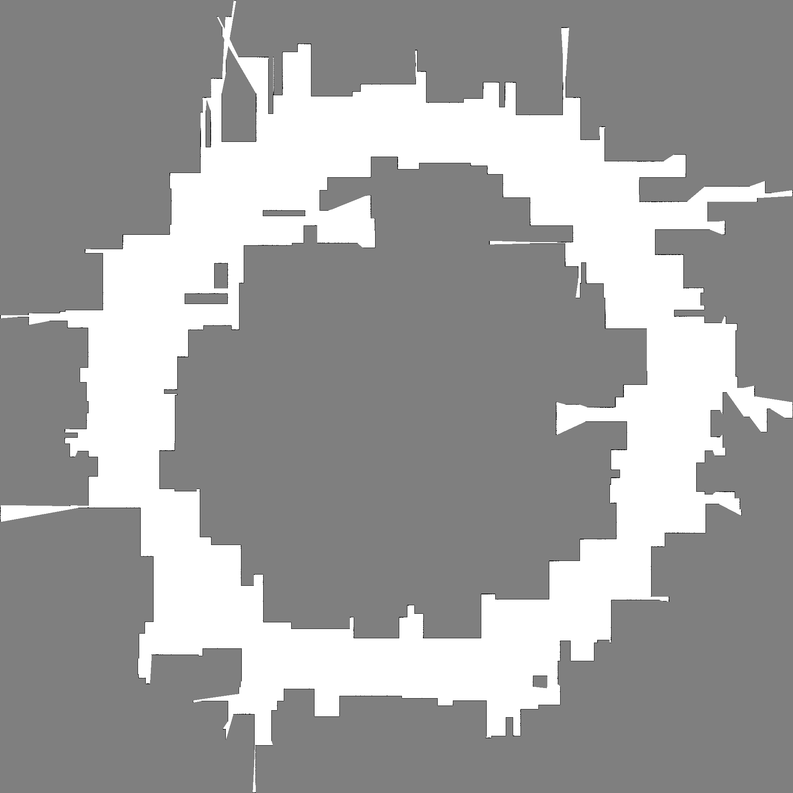
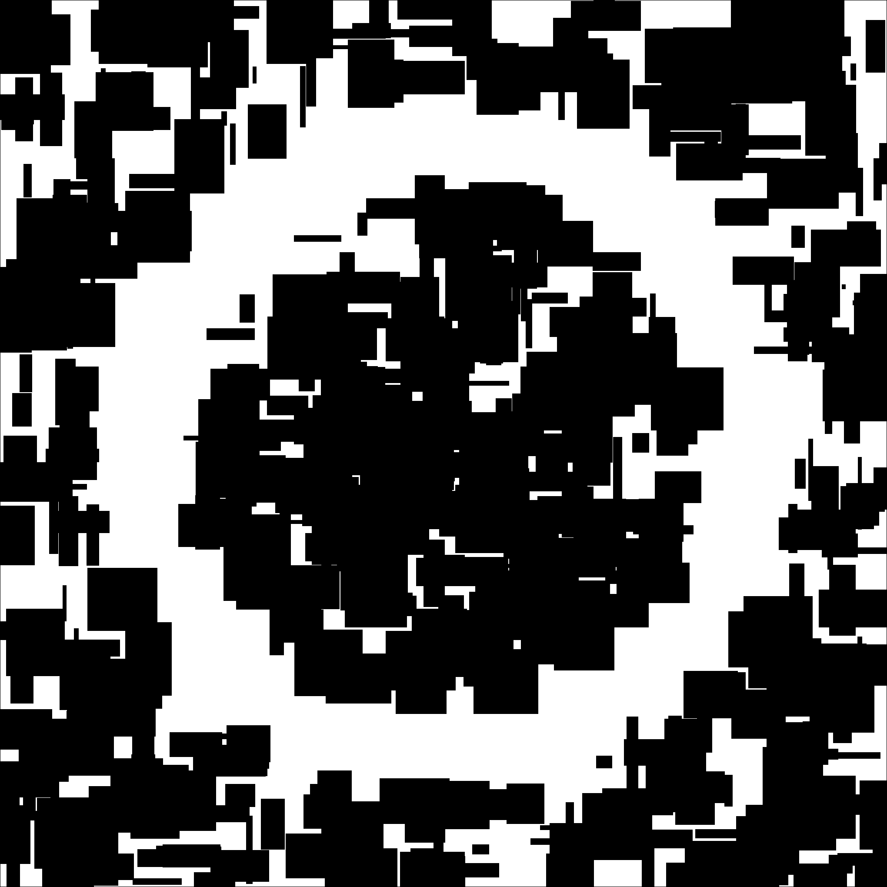

# Making 2D LiDAR Occupancy Grid Mapping from scratch

# Problem

I implement a serial baseline for a robotics mapping task: building a 2D occupancy
grid map from many LiDAR scans.

The map is a grid of cells. Each cell stores how likely it is occupied by an
obstacle. The robot moves along a trajectory and takes scans with many beams. Each
beam says either:

- a hit occurred at some distance (there is likely an obstacle there), or
- no hit until max range (the beam path is likely free space).

This is a realistic robotics workload because mapping is used in mobile robot
navigation and autonomous systems, and ray casting + grid updates are
computationally heavy.

# How the algorithm/baseline code works

Source file: `raycast_mapping.cc`

1. **Create a synthetic world**
   - Build a binary ground-truth occupancy map (`true_occ`) with wall boundaries
     and random rectangular obstacles.
   - Use a fixed random seed for deterministic behavior.

2. **Create robot trajectory**
   - Generate `scans` robot poses on a circle (`path_radius`) around the map
     center.

3. **Simulate LiDAR measurement (ray casting)**
   - For each pose and each of `beams` directions, run DDA grid traversal until:
     - a true obstacle is hit, or
     - `max_range` is reached.
   - The hit distance is the synthetic LiDAR range.

4. **Integrate into estimated occupancy map**
   - Maintain a log-odds grid (`est_logodds`).
   - Along beam path before the hit: apply negative update (free-space evidence).
   - At hit cell: apply positive update (occupied evidence).
   - Clamp log-odds values to keep them bounded.

5. **Report runtime and quality indicators**
   - Print `main_compute_seconds` for the mapping loop.
   - Compare estimated occupied cells vs ground truth and print occupied-cell IoU.
   - Print a checksum for reproducibility.
   - Optionally write PPM image (`--out-ppm`) for visual inspection.

Compile and run example:

```bash
clang++ -O3 -Wall -std=c++17 raycast_mapping.cc -o raycast_mapping
./raycast_mapping --width 1024 --height 1024 --scans 1500 --beams 720 --max-range 220 --obstacles 140 --path-radius 300
```

Tested preset on Miyabi (serial baseline):

```bash
%%sub
cd code
./raycast_mapping \
    --seed 42 \
    --width 2040 \
    --height 2040 \
    --scans 80000 \
    --beams 4320 \
    --max-range 600 \
    --obstacles 600 \
    --path-radius 700 \
    --out-ppm map.ppm \
    --out-gt-ppm map_gt.ppm
```

Observed runtime for this preset: about **168 seconds**.

Main size knobs:

- `--width`, `--height` (grid size)
- `--scans` (number of robot poses)
- `--beams` (beams per scan)
- `--max-range` (ray length)
- `--obstacles` (map complexity)
- `--path-radius` (trajectory size)

Output images from the above run:

- Estimated occupancy map: `map.ppm` (converted preview: `map.png`)
- Ground-truth occupancy map: `map_gt.ppm` (converted preview: `map_gt.png`)




# Where is parallelism

The workload has large data parallel structure.

- **Across beams (within one scan):** each beam can be ray-cast independently.
- **Across scans/poses:** each pose has a similar per-beam workload.
- **Across cells (for post-processing/metrics):** thresholding and comparisons are
  independent per cell.

Possible mappings:

- **Multicore CPU:** parallel for over beams (and/or scans).
- **GPU:** one thread per beam for ray casting and map updates.

Main expected limits to speedup:

- many beams may update nearby cells (write conflicts / atomics),
- memory bandwidth and irregular memory access in grid traversal,
- load imbalance because some rays terminate early and others run to max range.
